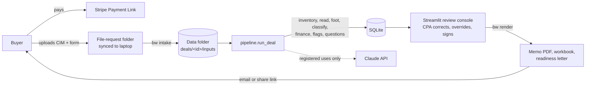

# Flash Review — technical plan (full stack)

Written 6 Nov 2026 for the 9–20 Nov sprint. Companion to `docs/build-plan.md` (what and why) and
`tasks/sprint.md` (checklist). Everything here is a recommendation for Chan to approve; open choices
are listed in section 12 and in `docs/decisions.md`.

## 1. Summary

Everything runs **on Chan's machine** for the sprint: a Python package, a local SQLite database, a
local data folder for client files, a command-line tool (`bw`) for the pipeline, and a Streamlit
review console. Buyers touch only three things: a Stripe Payment Link, an upload link with a short
intake form, and the delivered PDF memo and workbook. Nothing is hosted, so there is no server to
secure or keep running.

| Layer | Choice | Why | Not chosen (for now) |
|---|---|---|---|
| Language | Python 3.12 | Same as the MVP; every library below is Python | — |
| Data contracts | Pydantic 2 (`schemas.py`, done) | One validated shape for every stage | dataclasses (no validation) |
| Database | **SQLite** + SQLAlchemy 2.0 ORM + Alembic | One user, local, zero operations, file backup; same tools as the MVP so the move to Postgres is the same path | Postgres now (a server to run for one user) |
| Client files | Local data folder **outside the repo** (`BIZWAVE_DATA_DIR`) | Client PDFs never near git or Claude Code's working folder | Cloud storage bucket (needs hosting) |
| Rules | YAML files + strict loader (done) | Thresholds and lender views change without code changes | Database tables (harder to review in a diff) |
| PDF reading | pdfplumber (text, words, tables); pypdf (split one page); pypdfium2 (page images for the console) | Pure Python, page coordinates for source references | OCR engine (Tesseract): Windows setup cost, weak on tables; Claude covers scanned pages |
| Claude | Anthropic SDK, structured outputs, `claude-sonnet-5-5`, four registered uses (done) | Typed answers; one door with logging and a no-LLM mode | Agent frameworks (unnecessary) |
| Pipeline | Plain Python functions called by `pipeline.run_deal()` | Easy to test and re-run; stage status stored in the database | Task queues or workflow engines (no concurrency need) |
| Command line | Typer (`bw ...`) | Fast to build, self-documenting | A web API (no outside caller yet) |
| Review console | **Streamlit**, local only | Data tables with editing, PDF page preview, buttons, in hours not days | React or Flask pages (days of front-end work) |
| Memo and letter | Word templates filled with docxtpl, converted to PDF by LibreOffice | Chan edits the template in Word; same PDF on any machine | HTML-to-PDF (template editing in code) |
| Workbook | openpyxl with live formulas + MVP `xlsx_style` (done) | CPA can audit every formula | Values-only export |
| Payments | Stripe Payment Links | No code; collects email and terms consent | Stripe Checkout API + webhooks (needs a server) |
| Uploads | A file-request link per deal (OneDrive "Request files" or Dropbox File Request) + a short intake form | Buyers upload without an account; files sync to Chan's machine | Building an upload page |
| Tests | pytest; LibreOffice Excel parity; ground-truth accuracy; golden output test | Numbers proven, not eyeballed | — |
| CI | GitHub Actions running pytest on every pull request (optional, Day 1) | Catches a broken main | — |

## 2. Architecture



The database holds the state of every deal and every decision; the data folder holds the files.
Code computes every figure; Claude reads unreadable pages and drafts prose; the CPA decides and signs
(CLAUDE.md, section 2).

## 3. Where things live

| What | Where | In git? | Backed up |
|---|---|---|---|
| Code, rules, templates, tests, synthetic fixtures | the repository | yes | GitHub |
| Client PDFs, intake answers, rendered deliverables | `BIZWAVE_DATA_DIR/deals/<deal-id>/{inputs,work,outputs}` (default `~/BizWaveData`) | never | nightly copy to an encrypted backup |
| Database | `BIZWAVE_DATA_DIR/bizwave.db` | never | nightly `sqlite3` backup (see gotcha) |
| Run log fallback (JSON lines) | `BIZWAVE_DATA_DIR/runlog.jsonl` until the `llm_calls` table exists | never | with the data folder |
| Secrets | `.env` in the repo folder (git-ignored) | never | password manager |

**Gotcha: never put the live SQLite file inside a OneDrive or Dropbox synced folder.** Sync clients
copy the file while it is open and can corrupt it. Keep the database in a plain folder and back it up
with SQLite's backup command (`bw backup`) into the synced folder instead.

## 4. Database

### 4.1 Design

- **Relational tables** for anything queried, decided on or audited: deals, documents, pages,
  add-backs, flags, overrides, payments, credits, Claude calls.
- **JSON columns** (validated by the Pydantic schemas on the way in and out) for things always read
  as a whole: a statement with its lines and source references, financeability inputs and results.
  This keeps the schema small while keeping every figure's source reference.
- **Money:** commercial amounts (prices, payments, credits) are integer cents. Figures read from
  documents are `Decimal` stored as text (inside JSON, or a `DecimalText` column type), never SQLite
  `REAL`, so a footing check sees exactly what was printed.
- **SQLite settings on every connection:** `PRAGMA foreign_keys=ON`, `PRAGMA journal_mode=WAL`.
- **Migrations:** Alembic, one migration per packet, each tested with upgrade → downgrade → upgrade
  (the MVP's rule). Keep models Postgres-compatible: no SQLite-only SQL, no raw SQL without a reason.

### 4.2 Tables

Built in the packet that first needs them (section 9).

| Table | Key columns | Packet |
|---|---|---|
| `customers` | id, name, email, firm, referred_by, created_at | Day 1 |
| `deals` | id (code name slug, e.g. `acme-hvac`), customer_id, tier (`instant` / `flash` / `flash_qoe`), status, list_price_cents, asking_price, proposed_price, industry, offer_deadline, package_complete_at (SLA start), due_at, delivered_at, verdict, buyer_decision, buyer_decision_at, created_at, updated_at | Day 1 |
| `deal_events` | deal_id, at, kind (status change, SLA pause or resume, note), from_status, to_status, by, detail | Day 1 |
| `documents` | deal_id, filename, kind (cim, recast, p_and_l, balance_sheet, other), sha256, size_bytes, page_count, stored_path, received_at; one row per content (deal, sha256) and per file (deal, stored_path): a changed file at a recorded path is refused, saved under a new name instead | Day 1 |
| `pages` | document_id, page_no, chars, has_text_layer, tables_found, images, read_status (pending, text, table, claude, manual, unread, skipped), run_id | Day 1 |
| `pipeline_runs` | deal_id, started_at, finished_at, status, git_sha, rules_hash, llm_mode, stage results (JSON), error | Day 1 |
| `statements` | deal_id, run_id, kind, units, data (JSON: `schemas.Statement`) | Day 3 |
| `addbacks` | deal_id, run_id, ext_id, description, amounts (JSON), sources (JSON), rule_id, classified_by, confidence, lender_view, support_required (JSON) | Day 3 |
| `footing_results` | run_id, statement_id, check, period, line_id, expected, found, difference, passed, severity, message, resolution, resolved_by, resolved_at, reason | Day 4 |
| `overrides` | deal_id, entity (line value, add-back, flag, footing result), entity_id, field, old_value, new_value, **reason (required)**, by, at — the audit trail | Day 4 |
| `financeability_runs` | deal_id, created_at, earnings (JSON), structure (JSON), result (JSON), params_version, params_verified, is_final | Day 2 |
| `flags` | deal_id, run_id, rule_id, severity, title, detail, evidence (JSON), raised_by, status (open, kept, dismissed), decided_by, decided_at, reason | Day 5 |
| `questions` | deal_id, audience (seller, broker), text, source (rule id, flag id, CPA), rank, included | Day 5 |
| `loi_terms` | deal_id, term_key, text, included | Day 5 |
| `review_sessions` | deal_id, started_at, ended_at, minutes (CPA time for the scorecard) | Day 6 |
| `deliverables` | deal_id, kind (memo, workbook, letter), version, path, sha256, rendered_at, signed_by, signed_at, sent_at | Day 7 |
| `payments` | deal_id, provider, external_id, amount_cents, status, paid_at | Day 8 |
| `credits` | customer_id, source_deal_id, amount_cents, issued_at, expires_at, status (open, redeemed, expired), redeemed_ref, redeemed_at | Day 8 |
| `llm_calls` | deal_id, use, event, prompt_version, prompt_sha, model, input_sha, stop_reason, latency_ms, input_tokens, output_tokens, output (JSON), error, created_at | Day 8 (replaces the JSON-lines run log) |

### 4.3 Deal status

```
created -> awaiting_payment -> awaiting_documents -> ready (SLA clock starts)
        -> processing -> in_review -> approved -> delivered
side states: on_hold (waiting on the buyer; SLA paused), cancelled
```

From `on_hold` a deal goes back only to the status it had before the hold, or to `cancelled`, so a hold
can never skip `ready` or the pipeline run (Chan, P2, 2026-11-06). As built in P2 (`db/status.py`).

Every change writes a `deal_events` row. `bw status` lists open deals with time left on the SLA.

### 4.4 Re-runs and CPA edits

A pipeline run never overwrites another run's results; each run has its own `run_id`. CPA decisions
live in `overrides` and `footing_results.resolution` against that run. For the sprint, once a deal is
`in_review`, `bw run` refuses to re-extract unless given `--force`, which starts a new run and lists
the previous run's overrides for the CPA to re-apply. (Carrying overrides across runs automatically is
a post-sprint improvement.)

## 5. Pipeline

`pipeline.run_deal(deal_id)` runs these stages in order and records each stage's status, timing and
counts in `pipeline_runs`. Each stage is a function with a unit test; the pipeline only sequences them.

| # | Stage | Module | Writes | Claude? |
|---|---|---|---|---|
| 1 | Inventory pages | `ingest.inventory` (done) | `pages` | no |
| 2 | Read statements and the add-back schedule | `ingest.read` | `statements`, `addbacks` | `ingest.page_extraction` for pages with no text layer or no readable table |
| 3 | Footing checks | `validate` (done) | `footing_results` | no |
| 4 | Classify add-backs | `classify` (done) | `addbacks` (rule, view) | `addbacks.classify_unmatched` for leftovers |
| 5 | Supportable earnings and financeability | `finance` (done) | `financeability_runs` | no |
| 6 | Flags | `flags.engine` | `flags` | `flags.cim_qualitative` (suggestions, status open) |
| 7 | Questions and LOI terms | `flags.questions`, `flags.loi_terms` | `questions`, `loi_terms` | no |

Rendering (`bw render`) is separate because it runs after CPA sign-off; it is where
`narrative.draft` is called. With `BIZWAVE_NO_LLM=1` every stage still completes: unread pages show up
in the console for keying in, unmatched add-backs wait for the CPA, and narrative is typed by hand.

**Supportable earnings** (stage 5): reported earnings for each year plus the add-backs whose effective
lender view is accepted (or accepted on override), minus deductions. The memo shows three columns:
as presented by the seller, supportable, and the difference with reasons. Financeability uses only
the supportable column.

## 6. Interfaces

### 6.1 Command line (`bw`)

| Command | Does |
|---|---|
| `bw new-deal --customer EMAIL --tier flash` | creates customer (if new) and deal; prints the code name |
| `bw intake DEAL --from FOLDER` | copies files into the data folder, hashes them, runs the inventory, records documents and pages; reads the intake form answers (JSON or CSV export); marks `ready` and starts the SLA clock when payment and package are complete |
| `bw run DEAL [--no-llm] [--force]` | runs the pipeline |
| `bw console` | starts the review console on localhost |
| `bw finance DEAL` | prints the financeability result for the saved structure (useful on calls) |
| `bw render DEAL` | renders memo, workbook and letter into `outputs/`, records `deliverables` |
| `bw deliver DEAL` | marks sent, issues the credit, records the time |
| `bw status` | open deals, status, SLA time left |
| `bw backup` | SQLite backup plus data folder copy |
| `bw accuracy` | runs the pipeline on the ground-truth samples and prints the accuracy report |

### 6.2 Review console (Streamlit, localhost only)

1. **Queue:** open deals, status, time left; start or stop the CPA timer (`review_sessions`).
2. **Documents:** pages with read status; any unread page shows its image beside a key-in form (read
   method `manual`, page number recorded).
3. **Figures:** each statement with the page each figure came from (click to see the page image);
   footing results; resolve a failure by correcting the figure or accepting it, always with a reason.
4. **Add-backs:** seller description, rule, method, confidence, lender view, support needed; override
   with a reason; supportable earnings update live.
5. **Financeability:** structure form (buyer cash, notes, rate, replacement salary, capex, basis);
   result, maximum financeable price, sensitivity; save as final.
6. **Flags, questions, LOI terms:** keep or dismiss flags; edit, reorder and include questions and terms;
   choose the verdict and its three reasons.
7. **Sign-off:** checklist (no open serious flag, footing resolved, verdict set, timer stopped) →
   render → review the PDF → sign → deliver.

Streamlit reruns the whole script on every click: keep state in `st.session_state`, open a database
session per rerun, cache the rules with `st.cache_resource`, and run it bound to localhost only.

### 6.3 What the buyer touches

- **Stripe Payment Link:** $750 list, $295 pilot; collects email; terms-of-service consent linking to the
  engagement terms; redirects to the intake page.
- **Intake page:** a short form (asking price, proposed price, buyer cash, seller-note ideas, lender and
  quoted rate if any, working capital, offer deadline, industry, consent to AI-assisted processing) plus
  the deal's file-request link for the CIM and anything else the broker sent.
- **Delivery:** memo PDF and workbook by email or an expiring share link; the readiness letter as a
  separate PDF the buyer can forward to the broker.

## 7. Claude

Four registered uses, already wired (`llm/register.py`): page extraction, unmatched add-back
classification, qualitative CIM flags, narrative drafting. Model `claude-sonnet-5-5` for all, set by
`BIZWAVE_LLM_MODEL`; structured outputs through `client.messages.parse(..., output_format=Model)`.
For page extraction, split the page into a one-page PDF (pypdf) and send it as a base64 `document`
block, so the page number is known by construction.

Cost: earlier BizWave analysis put API cost under 1% of revenue. The run log records tokens per call,
so measure it on the first live reviews rather than estimating.

## 8. Security and client data

- **Keep client data outside the repository** (`BIZWAVE_DATA_DIR`). `.claude/settings.json` in the repo
  denies Claude Code reads of `.env`, `deals/` and the default data folder as a second guard. A deny
  rule is a guard, not a wall: Claude Code's shell can still read files, so the folder location is the
  real protection. **If you move the data folder or the run log, add a matching `Read(...)` deny rule:
  the shipped rule covers only the default `~/BizWaveData`.**
- **Build and debug with synthetic or redacted samples in Claude Code.** Anything Claude Code reads or
  prints goes to the model. Run live client deals yourself, in a normal terminal and the console.
- **The pipeline itself sends pages to the Claude API by design.** Disclose AI-assisted processing in the
  engagement letter, and check Anthropic's commercial terms on API data use before the first live review.
- Full-disk encryption on the laptop (BitLocker or FileVault); MFA on email, Stripe, GitHub, OneDrive or
  Dropbox, and the Anthropic console; API key only in `.env`.
- Retention: state in the engagement letter how long client files are kept; `bw purge DEAL` (post-sprint)
  deletes a deal's files and redacts its database rows.

## 9. Packets by day (about 54 hours)

Each packet: plan doc in `tasks/plans/`, tests first, whole suite green, stop for Chan (CLAUDE.md §6).

| Day | Packet | Hours | Done when |
|---|---|---|---|
| Mon 9 | **P1 Settings and data folder:** `config.py` (python-dotenv), `BIZWAVE_DATA_DIR`, run log moved there | 0.5 | tests pass with a temp data folder |
| Mon 9 | **P2 Database core:** SQLAlchemy models for customers, deals, deal_events, documents, pages, pipeline_runs; Alembic baseline; round-trip test; `DecimalText` type | 2.5 | migrations round-trip; models tested with real values |
| Mon 9 | **P3 CLI skeleton:** `bw new-deal`, `bw intake`, `bw status`, `bw backup` | 1.5 | intake of a synthetic folder records documents and pages |
| Mon 9 | Non-code: 8–10 sample CIMs (redacted or public where possible), outreach, engagement letter | 3 | |
| Tue 10 | Decisions D1–D3 (SOP text, earnings basis, lender views) | 2 | YAML statuses updated |
| Tue 10 | Ground truth: hand-key 3 samples into `truth.yaml` (periods, lines, add-backs, pages) | 3 | |
| Tue 10 | **P4 Financeability persisted:** `financeability_runs`, structure from the intake form, `bw finance` | 1 | |
| Wed 11 | **P5 Statement reader:** words and tables from the text layer, period headings, line kinds, sections, parents, add-back schedule; `statements` and `addbacks` tables | 5 | synthetic PDFs read exactly, with page numbers |
| Wed 11 | **P6 Claude page fallback:** one-page PDF to `ingest.page_extraction`, schema validation, no-LLM path | 2 | fake-transport tests; one live check on a scanned sample |
| Thu 12 | **P7 Pipeline orchestrator:** `run_deal`, stage records, `footing_results`, `overrides` | 2 | `bw run` end to end on a synthetic deal |
| Thu 12 | **P8 Accuracy report** against the ground truth; tune readers and patterns; set D5 | 4 | report saved; misses listed |
| Fri 13 | **P9 Flag engine:** one function per metric in `rules/flags.yaml`; `flags` table | 2 | every metric unit-tested |
| Fri 13 | **P10 Questions and LOI terms:** `rules/questions.yaml`, `rules/loi_terms.yaml` (seeded from the MVP screening questions and playbooks) | 2 | |
| Fri 13 | **P11 End to end on 5 samples**, also with `--no-llm` (week-1 gate) | 1 | gate met; 3 partners confirmed |
| Mon 16 | **P12 Review console** (first to cut: review in the workbook instead) | 6 | a deal goes from in_review to approved in the console |
| Tue 17 | **P13 Outputs:** memo and letter Word templates, docxtpl render, LibreOffice PDF, workbook; banned-language test | 5 | golden render of a synthetic deal; text extracted from the PDF matches the figures |
| Tue 17 | **P14 Narrative drafts** via `narrative.draft` (second to cut) | 1 | |
| Wed 18 | **P15 Operations:** `rules/sla.yaml` and SLA clock, `rules/commercial.yaml`, payments, credits ledger, `llm_calls` table, CPA timer; Stripe link and upload link set up | 3 | |
| Wed 18 | First live Flash Review | 2 | delivered, minutes logged |
| Thu 19 | Live reviews 2–3 (third to cut), fixes, redacted sample for the deck | 6 | |
| Fri 20 | Demo day | | |

## 10. Testing

- **Unit tests** per module with real values (done for finance, rules, footing, classifier, Claude door).
- **Database:** Alembic upgrade → downgrade → upgrade in a temp folder for every migration.
- **Excel parity:** LibreOffice recalculates the model and every row is compared (done).
- **Accuracy:** `bw accuracy` compares pipeline output with the hand-keyed ground truth: figures read
  correctly, footing results, add-backs classified correctly, with and without Claude.
- **Golden output:** render a synthetic deal, extract the PDF text, check every key figure appears as
  computed and that banned value language does not ("worth", "valuation", "value range",
  "fair market value", "enterprise value").
- **Console smoke test:** Streamlit's `AppTest` loads each page with a synthetic deal.
- **CI (optional):** GitHub Actions runs `pytest -m "not excel"` on every pull request.

## 11. Repository layout (target by 20 Nov)

```
src/bizwave_preloi/
  config.py              settings from .env: data folder, database URL, LLM mode, model
  schemas.py  pl_ladder.py                                   (done)
  db/                    models.py, session.py, repo.py (Pydantic <-> ORM), types.py (DecimalText)
  rules/                 addbacks, flags, sba_sop_8_1, taxonomy, validation (done);
                         questions, loi_terms, commercial, sla (to add)
  ingest/                inventory.py (done), read.py, headings.py, page_fallback.py
  validate/  classify/  finance/  llm/                       (done)
  flags/                 engine.py, metrics.py, questions.py, loi_terms.py
  outputs/               memo.py, workbook.py, letter.py, convert.py, templates/*.docx
  ops/                   runlog.py (done), sla.py, credits.py, intake.py, backup.py
  pipeline.py            run_deal()
  cli.py                 the `bw` command
console/app.py           Streamlit review console (pages/ for each screen)
migrations/              Alembic
tests/                   unit, db, accuracy (reads local samples, skipped when absent), golden
```

New dependencies: `sqlalchemy>=2`, `alembic`, `typer`, `streamlit`, `pypdf`, `pypdfium2`, `docxtpl`,
`python-dotenv`. System: LibreOffice (PDF conversion and the parity test).

## 12. Decisions this plan adds

| # | Decision | Recommendation |
|---|---|---|
| D10 | What "24 business hours" means for the SLA clock | 24 clock hours that skip Saturdays, Sundays and US federal holidays (Friday 3pm → Monday 3pm); stored in `rules/sla.yaml` |
| D11 | Upload tool | OneDrive "Request files" or a Dropbox file request (no account needed to upload); confirm size limits on Day 8 |
| D12 | Real sample CIMs in Claude Code | Use redacted or public samples for building; live deals only outside Claude Code |
| D13 | Engagement letter signature | Terms consent at Stripe checkout plus an e-signed letter for the pilots |
| D14 | Delivery channel | Email the PDF and workbook, or an expiring share link |
| D15 | Credit terms | 100% of the fee, 120 days, any deal, not transferable; in `rules/commercial.yaml` |

## 13. After the sprint

- **Hosted Instant Screen** (self-serve): a small FastAPI service with Postgres and object storage, or
  folded into the MVP stack; the pipeline package is reused as is.
- **Postgres** when a second user or a hosted service arrives: same SQLAlchemy models, Alembic
  migrations replayed on Postgres.
- **QoE handoff:** add-backs already carry the MVP's category codes and `mvp_subtype`, so a Flash
  Review can seed a QoE workspace.
- **Flash QoE tier:** tax returns and bank statements, deposit tie-out, return-to-P&L reconciliation; the
  MVP's anomaly engine becomes relevant once monthly data is in scope.
- **OCR** only if scanned inputs turn out to be common and Claude page reads are too slow or costly.

## 14. Working in Claude Code

1. Merge the `scaffold/day-0` pull request, then:
   ```bash
   git clone https://github.com/Bizwave/pre-loi && cd pre-loi
   python -m venv .venv && .venv\Scripts\activate        # macOS/Linux: source .venv/bin/activate
   pip install -e ".[dev,llm]"
   pytest
   claude
   ```
2. Install LibreOffice if it is not installed (needed for PDFs and the parity test); set `SOFFICE` if it is
   not on PATH.
3. First prompt: *"Read CLAUDE.md, docs/tech-plan.md and tasks/sprint.md. Write the packet plan for P1
   and P2 in tasks/plans/ with the data contract and the tests you will write first. Don't build until I
   approve."*
4. Use plan mode for each packet; approve; Claude Code writes tests, then code, runs `pytest`, stops.
5. `CLAUDE.md` does not yet describe the database, console or CLI. Let the P2 packet propose that
   update, and approve it explicitly (the file says it changes only with Chan's consent).
